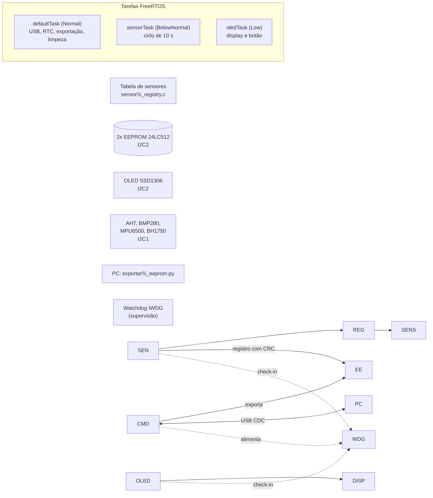

# Datalogger ambiental autônomo (STM32F411 + FreeRTOS)

Datalogger de baixo custo alimentado por bateria: lê sensores I2C com período de 10 s, grava os registros com CRC em duas
EEPROMs, mostra o estado em um OLED e exporta tudo para CSV por USB. Projeto de TCC, em uma PCB própria.

> \\\*\\\*Estado:\\\*\\\* firmware \\\*\\\*V13.1\\\*\\\* validado em hardware nos testes de aquisição, integridade, exportação, RTC/CR2032, watchdog e
> combinações de sensores, e com o consumo medido. O ensaio de estabilidade prolongada também foi executado (12 h 07 min até encher a memória).
> Resultados em \\\[docs/RESULTADOS\\\_DOS\\\_TESTES.md](docs/RESULTADOS\\\_DOS\\\_TESTES.md); histórico em \\\[CHANGELOG.md](CHANGELOG.md).

\## Documentação


A documentação técnica do projeto, gerada com Doxygen, está disponível online:


\[\*\*Acessar documentação Doxygen\*\*](https://cristianoteruia.github.io/PlataformaModular/)


## O que faz

* **Aquisição** a cada 10 s: AHT20/AHT21 (temperatura e umidade), BMP280 (pressão), MPU6500 (acelerômetro e giroscópio)
e BH1750 (luminosidade), todos no I2C1. Os sensores são **modulares**: cada um é uma linha de uma tabela
(`Core/Src/sensor\\\_registry.c`); a ausência de um módulo não é erro, e o registro grava só os sensores presentes.
* **Armazenamento**: duas EEPROMs 24LC512 (I2C2), registros de tamanho variável (até 38 bytes) com máscara de sensores,
data/hora do RTC e CRC-16/CCITT.
* **Exportação** por USB (CDC) para CSV, com um script em Python que também acerta o RTC com a hora do computador.
* **Relógio** pelo RTC interno, mantido por uma CR2032 no pino VBAT.
* **Robustez**: watchdog independente (IWDG) com supervisão por tarefa, recuperação automática do barramento I2C2 e
um comando de diagnóstico (`DIAG`) que mostra o estado interno sem depurador.
* **Display**: SSD1306 com duas telas alternadas, que apaga sozinho e acende pelo botão (V13).
* A análise dos dados no PC não é o foco; há scripts de exemplo em `tools/`.

## Hardware

|Item|Detalhe|
|-|-|
|MCU|STM32F411 (placa Black Pill), 16 MHz (HSI); PLL só para o USB|
|Barramento I2C1|sensores (AHT20/21 + BMP280, MPU6500, BH1750)|
|Barramento I2C2|2× EEPROM 24LC512 (endereços diferentes) + OLED SSD1306|
|Alimentação|bateria 18650 → TP4056 → MT3608 (5 V); USB-C; CR2032 no VBAT|
|Tempo|RTC interno (LSE), IWDG|

Limitação de projeto conhecida: a USB e a bateria não podem ser ligadas ao mesmo tempo, então exportar exige
desconectar a bateria (a hora é mantida pela CR2032). Uma revisão futura da PCB pode incluir um circuito de
alimentação por diodo ideal.

## Arquitetura



Mutexes: `eepromMutex` (registros), `i2c2Mutex` (barramento compartilhado por OLED e EEPROMs), `sensorDataMutex`
(valores dos sensores) e `rtcMutex` (leitura/ajuste do RTC). O IWDG só é alimentado se **todas** as tarefas
registraram atividade dentro do prazo; operações longas (exportação e limpeza) também alimentam o watchdog.

### Formato do registro

`\\\[máscara 1 B]\\\[dados dos sensores presentes, na ordem da tabela]\\\[RTC 7 B]\\\[CRC-16 2 B]`

Bits da máscara: AHT = 0, BMP280 = 1, MPU6500 = 2, BH1750 = 3, ENS160 = 4. Registros antigos continuam válidos quando
um sensor novo é adicionado. O CSV tem uma coluna de cada sensor e deixa vazios os campos dos sensores ausentes.

Capacidade observada: 4360 registros de 30 bytes (≈ 12 h a 10 s) nas duas EEPROMs. Com a memória cheia o sistema para de
gravar e avisa no OLED.

## Uso

```text
# Compilar: abrir no STM32CubeIDE, Clean + Build, gravar (ST-Link).
python tools/exportar\\\_eeprom.py --port COM3      # exporta o CSV, acerta o RTC e oferece limpar a memória
python tools/diag.py --port COM3                 # estado interno (tarefas, I2C, sensores, watchdog, OLED)
python tools/comparar\\\_csv.py antigo.csv novo.csv # verifica se duas exportações são equivalentes
python tools/verificar\\\_csv.py arquivo.csv        # integridade do CSV (ordem, lacunas, duplicatas, zeros, ano 2000)
```

Opções de compilação em `Core/Inc/app\\\_config.h`: `ENABLE\\\_WDT\\\_TEST` (comando de teste do watchdog),
`ENABLE\\\_IDLE\\\_WFI` (sono na tarefa ociosa; ponha 0 ao depurar) e `OLED\\\_AUTO\\\_OFF\\\_MS`.
O comando `CLEAR` exige a confirmação explícita `CLEAR,CONFIRMO` (o script do PC ainda pede que se digite `APAGAR`).

## Testes

```text
make -C tests      # precisa só de gcc e make
```

Testes no PC (sem placa) sobre o código real do firmware: formato do registro e CSV (equivalência com a versão anterior,
bytes e texto), drivers do BH1750 e do ENS160 contra dispositivos I2C simulados, tabela de sensores, ordem de
sono/despertar do MPU6500 e a política de energia do OLED. São \~840 mil verificações. Erros introduzidos de propósito
no código são detectados. Há um workflow do GitHub Actions (`.github/workflows/host-tests.yml`) que ainda não foi executado no GitHub.
Eles **não** substituem os ensaios em hardware.

## Validação em hardware

Ensaios de 04/11/2026 (firmware V13.1), detalhes em [docs/RESULTADOS\_DOS\_TESTES.md](docs/RESULTADOS_DOS_TESTES.md); evidências em [docs/evidencias](docs/evidencias/).

|Verificação|Resultado|
|-|-|
|Aquisição contínua (30 min)|181 registros, intervalo médio 9,994 s, sem reinício, lacuna ou duplicata; exportados = informados pelo STM32|
|Integridade dos CSVs|0 registros suspeitos; sem duplicatas, retrocessos de horário ou valores fora de faixa|
|Exportação sem limpar|`IDENTICO`: 215 registros reproduzidos + 125 novos|
|RTC e CR2032|a hora sobrevive sem a alimentação principal; sem nenhuma alimentação os registros saem em ano 2000 e o ajuste pelo script restabelece (CR2032 a 3,25 V)|
|Watchdog|4 reinícios pelo IWDG (≈ 57 s cada); exportação e registros preservados|
|Combinações de sensores|máscaras 7, 11 e 3 conforme o esperado; registros de 30, 20 e 18 bytes na mesma memória|
|Consumo (bateria a 4,07 V)|27 mA (V12d) → **10 mA** (V13, OLED apagado); `WFI` ≈ −5 mA, OLED ≈ −7 mA, MPU6500 em sono ≈ −5 mA ([detalhes](docs/MEDICAO_ENERGIA.md))|
|Cadeia de alimentação|≈ 50 % da energia da bateria se perde no boost (75 a 81 %) e no regulador linear de 3,3 V|
|Margens|pilha da `defaultTask`: mínimo livre de 2232 B de 4096 B (V13.1, antes de uma exportação); heap: 24 KB livres de 32 KB, sem variação|
|OLED/I2C2|27 episódios de falha em 93 min (V8) → 0 em 108 min após a correção (V9)|
|Estabilidade prolongada (AHT20+BMP280+MPU6500)|8 h 55 min (3.212 registros) e 12 h 07 min até encher a memória (4.360 registros, a capacidade prevista), sem reinício por watchdog; lacunas só nas exportações ([detalhes](docs/RESULTADOS_DOS_TESTES.md))|

### Limitações conhecidas

* **ENS160 (qualidade do ar): não validado em hardware.** O driver existe, passa nos testes simulados e o sensor
responde no I2C (firmware 5.4.6), mas o módulo ENS160+AHT21 usado nunca completou uma medição com o VIN em 3,3 V
(leituras em zero). Com 5 V no VIN, as linhas SDA/SCL do módulo ficam em 5 V (medido), o que impediria ligá-lo ao
barramento de 3,3 V sem conversor de nível ou sem remover os pull-ups; esse teste com 5 V não foi feito.
A causa não foi confirmada (alimentação ou defeito do módulo). Por isso o sensor ficou fora dos ensaios.
* **Hora inválida não é marcada nos registros.** Se o RTC perder a hora (sem a CR2032 e sem alimentação), os registros saem com ano 2000
e **não são corrigidos** depois do ajuste; a indicação existe no OLED (`RTC:INVALIDO`).
* **Amostras podem ser perdidas durante a exportação e a limpeza** (a tarefa de sensores espera até 250 ms pelo mutex da EEPROM e descarta a amostra).
Não foi observado nas exportações curtas (≈ 2 s) dos ensaios.
* A detecção de CRC incorreto está no código, mas **não foi demonstrada experimentalmente**; a deriva do RTC e a exatidão física dos sensores
(sem instrumento de referência) não foram medidas.
* O bloco de metadados é reescrito a cada registro; a resistência a ciclos de escrita da 24LC512 (a confirmar no datasheet) limita o número de ciclos de encher e limpar a memória.
* A PCB comporta **dois módulos de sensores**. O módulo AHT20+BMP280 reúne temperatura, umidade e pressão em uma única placa; por isso, as combinações fisicamente previstas e ensaiadas foram AHT20+BMP280 com MPU6500 (máscara 7), AHT20+BMP280 com BH1750 (máscara 11) e AHT20+BMP280 sozinho (máscara 3). Não há uma configuração de quatro módulos nesta versão da placa.
* Mais de um módulo com AHT não pode ficar conectado (mesmo endereço, 0x38). Trocar módulos com o sistema ligado não é suportado.
* A USB e a bateria não podem ser ligadas ao mesmo tempo; sem modo de baixíssimo consumo (STOP): o MCU não é desligado entre as amostras.
* Autonomia **estimada**, não medida em descarga; os picos de corrente durante a aquisição não foram medidos.

## Decisões e lições aprendidas

1. **Falha intermitente do OLED.** O contador de falhas do `DIAG` mostrou falhas sempre em sequência, nunca isoladas: a cada recuperação do I2C2
correspondiam exatamente duas atualizações falhas (`failc` = 2 × `recov`; na V8 a recuperação disparava na segunda falha seguida). Isso indicava um estado
travado do I2C2, e não ruído. A causa mais provável, pela análise do código e pela taxa de ocorrência: esperas ocupadas (`HAL\\\_Delay`) de ≈ 180 ms na
tarefa de sensores, de prioridade maior que a do OLED, suspendiam uma transferência I2C além do timeout de 100 ms da HAL, que desiste sem gerar STOP.
A correção foi usar esperas que cedem a CPU: 27 episódios em 93 min antes, nenhum em 108 min depois. A causa não foi confirmada com analisador lógico.
2. **O CubeMX apagou código.** Regenerar o projeto apagou tudo o que estava fora dos blocos `USER CODE`. A aplicação
passou para arquivos próprios (`app\\\_tasks.c`, `app\\\_watchdog.c`, `sensor\\\_registry.c`), que a regeneração não toca.
3. **Watchdog supervisionado.** Alimentar o IWDG de um único ponto esconderia tarefas travadas; a alimentação depende do
check-in de cada tarefa, e as operações longas também alimentam o watchdog.
4. **Diagnóstico antes de otimizar.** A decomposição do consumo mostrou que o OLED e o MPU6500 somam ≈ 41 % e são
controláveis por software, o que guiou a V13. A medição mostrou ainda que o `WFI` rendeu ≈ 5 mA, mais do que o esperado.
5. **O verificador de CSV encontrou um defeito de agendamento.** O intervalo médio entre registros era 10,307 s, não 10 s: a tarefa de sensores
calculava o próximo despertar a partir do fim do ciclo. A correção (V13.1) foi verificada com o mesmo método (9,994 s e 9,997 s).
6. **Medir antes de concluir.** A eficiência da cadeia de alimentação foi medida (boost de 75 a 81 % e regulador linear a 65 %, cerca de metade da energia perdida),
o que aponta a arquitetura de alimentação, e não o firmware, como o maior ganho futuro de autonomia.

## Documentação do código (Doxygen)

O código da aplicação é comentado no formato Doxygen (funções, estruturas, constantes e variáveis globais, em
português), com uma página principal em `docs/mainpage.dox` (arquitetura, formato do registro, mapa da EEPROM e
protocolo USB).

```text
doxygen Doxyfile     # atualiza o HTML versionado em docs/api/html/index.html
cd docs/api/latex \\\&\\\& make   # PDF (refman.pdf); no Windows, make.bat
```

Precisa do [Doxygen](https://www.doxygen.nl/); para o PDF, de uma distribuição LaTeX (TeX Live ou MiKTeX) com o pacote de
português do babel. Os gráficos de chamadas exigem o Graphviz (ative `HAVE\\\_DOT` no `Doxyfile`). Os arquivos gerados pelo
STM32CubeMX (`main.c`, `stm32f4xx\\\_\\\*`, etc.) ficam fora da documentação. O HTML em `docs/api/html/` é mantido no repositório;
os arquivos intermediários da saída LaTeX e o log de avisos não são versionados.

O workflow `.github/workflows/doxygen-pages.yml` publica essa documentação no GitHub Pages a cada atualização da branch `main`.
Para ativá-lo, configure **Settings → Pages → Build and deployment → Source: GitHub Actions** no repositório.

## Estrutura

```text
Core/Src, Core/Inc   firmware (app\\\_tasks, app\\\_watchdog, sensor\\\_registry, eeprom24lc512, ssd1306, drivers...)
USB\\\_DEVICE/          CDC e comandos USB
tools/               exportar\\\_eeprom.py, diag.py, comparar\\\_csv.py, verificar\\\_csv.py, gráficos
tests/               testes no PC (make -C tests)
Doxyfile             configuração do Doxygen (HTML gerado em docs/api/html e versionado)
docs/                mainpage.dox (página principal do Doxygen), resultados dos testes, medição de energia, roteiro de testes, evidências (docs/evidencias) e histórico (docs/history)
CHANGELOG.md         resumo das versões
```

## Autoria e uso de ferramentas

<!-- Preencha conforme a política da sua instituição, incluindo o uso de ferramentas de IA, se houver. -->

